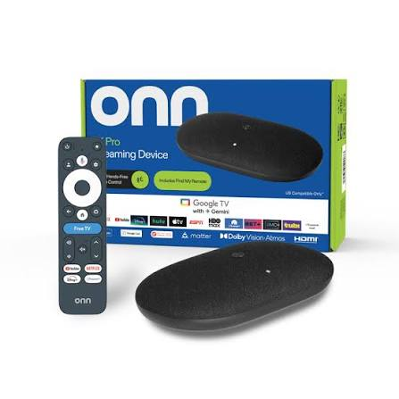

<p align="center">
  
</p>

# onn6x Launcher

A hackable Android TV home screen for the Onn 4K Pro, in Kotlin with Compose for TV.

<p align="center">
  
</p>

**Status:** builds and runs on an Onn 4K Pro (Google TV, Android 14). Built for one box and one owner, so treat it as a starting point, not a polished release.

## Features
**Home screen**
- Every launchable app, TV-style and phone-style (Kodi, emulators, sideloads included).
- Rows: Recent, Favorites, Streaming, Media, Games & Emulators, your own rows, Quick settings, All apps.
- **Recently used row:** filled from apps you open through this launcher or a remapped button
  (not from apps opened some other way, which would need the Usage Access permission).
- **Search:** top bar button. Type to filter apps. The remote's mic works if Gboard voice is set up.
- **Weather and date** in the top bar, from Open-Meteo (free, no key). Set a city in Settings.
- **Quick settings row:** Gemini/voice, Wi-Fi, Bluetooth, Display, Sound, Developer options, Sleep timer.
- Wallpapers (rotating), idle **screensaver**, accent color, tile size.

**Customizing**
- Hold OK on a tile: Open, Add to row, Remove, Move left/right, **Move row up/down**, Rename row,
  Delete row, Hide/Unhide, App info, Uninstall.
- **Settings** (top bar): tile size, accent, wallpaper timing, screensaver delay, recents, weather and units,
  location, new row, hidden row, Home override, remote remapping, backup/restore, safe mode.
- **Back up / restore layout:** saves rows, hidden apps, settings and remote mappings to
  `/sdcard/Android/data/com.example.onnlauncher/files/backup/layout.json`.
  `adb pull` it to keep a copy, `adb push` it back after a reset, then use Restore.

**Remote and safety (need the accessibility service, see below)**
- **Home button override:** the stock launcher stays enabled; we put ours on top of it.
- **Remote button remapping:** Settings > Remap remote buttons > press a button > pick an app.
- **Press Home while already on the home screen** to open the Quick menu (recent apps and shortcuts).
  Android never delivers a long-press of Home to apps, so this is the closest gesture that works.
- **Safe mode:** hold Back on the home screen. Options: turn the override off, open the stock Google TV
  home, Accessibility settings, Android settings. It also opens by itself, with the override off,
  if the previous launch died before finishing starting up.

## Build
1. Install Android Studio, open this folder, let Gradle sync (it offers to install Android SDK 34).
2. Build > Build Bundle(s) / APK(s) > Build APK(s). APK: `app/build/outputs/apk/debug/app-debug.apk`.

## Install
```
adb install app-debug.apk
adb shell am start -n com.example.onnlauncher/.MainActivity
```
That opens it like any app. Home doesn't change until you enable the service below.

## Turn on the accessibility service
```
adb shell settings get secure enabled_accessibility_services
```
If that prints `null`:
```
adb shell settings put secure enabled_accessibility_services com.example.onnlauncher/com.example.onnlauncher.HomeOverrideService
adb shell settings put secure accessibility_enabled 1
```
If it prints something else, keep it and append ours after a colon:
`existing.service/Name:com.example.onnlauncher/com.example.onnlauncher.HomeOverrideService`

Test: open Netflix or YouTube and press Home. You should land on this launcher. Press Home again on the
launcher to get the Quick menu.

**Turning it off, fastest first:** the "Home override" button on the top bar; hold Back for safe mode;
it switches itself off if it bounces 5 times in 10 seconds; restore the old accessibility value (or
`adb shell settings delete secure enabled_accessibility_services` if it was `null`);
`adb uninstall com.example.onnlauncher` removes everything.

**Themes**
- Settings > Theme cycles 8 built-in looks: Classic, Midnight, Sunset, Forest, Ocean, Neon City, Retro Arcade,
  OLED Black. A theme sets the accent, background wash, tile and dialog colors, tile corner shape, and (Retro Arcade)
  a monospace font. Settings > Accent color overrides the theme's accent; "Theme default" goes back to it.
- To add your own, add an entry to `Themes.all` in `Theme.kt`. Wallpapers still come from the wallpapers folder.

**Round 3 additions**
- **Phone editor:** Settings > Edit from your phone (or the "Phone editor" tile in Quick settings). The TV shows
  an address like `http://192.168.1.50:8080` and a 6-digit PIN. Open it on a phone or laptop on the same Wi-Fi.
  Tabs: Rows (add, rename, reorder, put apps in rows), Apps (rename, tile picture, hide), Look (settings,
  weather city, auto-start), Smart home, Files (wallpapers, APKs), Backup. It stops after 30 minutes or when you leave
  the launcher, and locks after 8 wrong PINs. Plain http, home network only.
- **Rename apps and custom tile pictures:** hold OK on a tile > Rename app. Pictures: phone editor > Apps >
  Tile picture, or `adb push com.some.app.png /sdcard/Android/data/com.example.onnlauncher/files/tiles/`
  (file name = package name; 16:9 fits best).
- **Auto-start app:** Settings > Open at startup. After a reboot the launcher counts down and opens that app.
  Any button press cancels. It only fires on the first launch after a boot, never when you just press Home.
- **Device info:** IP address, USB/wireless debugging, whether ADB is listening on 5555, storage, memory, uptime.
  Settings > Device info, or the Quick settings tile.
- **Install APKs:** put files in `.../files/apks/` (phone editor Files tab, or `adb push app.apk
  /sdcard/Android/data/com.example.onnlauncher/files/apks/`), then Settings > Install APKs. The first time,
  Android sends you to allow "Install unknown apps" for this launcher.
- **Smart home tiles:** Home Assistant service calls (`POST /api/services/<domain>/<service>` with a Bearer token)
  or any web address/webhook. Set them up in the phone editor (Smart home tab) and use Test there. They show as a
  "Smart home" row. The Home Assistant token is stored on the box only and is NOT included in backups. Cleartext
  http is allowed in the manifest so a local `http://` Home Assistant works.

## Themes, cards and look (latest)

- 12 themes in Settings > Theme (Classic, Midnight, Sunset, Forest, Ocean, Neon City, Retro Arcade, Glass, OLED Black, Brick & Sky, Ancient Ruins, Portal Lab). Some draw a background (bricks and clouds, hills, swirl).
- Auto day/night theme: Settings > Auto day/night theme, with a day and a night theme. It switches at the real sunrise and sunset for your weather city.
- Home layout: Compact (one strip) or Cards (weather and crypto side by side, above your rows).
- Forecast card: next hours, 5 days, sunrise and sunset (Open-Meteo, no key). Markets card: up to 6 coins in US dollars (CoinGecko, no key). Both can be turned off.
- Tile corners: Theme default, Soft, Round, Very round.
- Everything above can also be set from the phone editor (Look tab).

## Trending and discovery (TMDB)

Needs a free TMDB key: make an account at themoviedb.org, then Settings > API, and copy the API Key (or the long Read Access Token). Paste it in the phone editor (Look tab > TMDB) or Settings > TMDB API key. The key stays on the box and is not included in layout backups.

- **Hero banner:** a big backdrop under your first row, rotating every 15 seconds, with the title, official logo, year, rating and a short overview. Select it for details.
- **Poster row:** trending titles. Settings > "Titles shown" switches between Trending this week, Popular in your region (streaming services in your country), and My tastes.
- **Taste test:** Settings > "Take the taste test...". Three rounds of six posters; pick the ones you'd watch and the launcher learns your favorite genres and switches to My tastes.
- **Details dialog:** overview, rating and where it streams in your region, with a button for each matching app you have installed. Netflix, YouTube and Prime Video also get "Search for it in ..." (a search link that may stop working when those apps change; if an app refuses it, the launcher just opens the app).
- **Continue watching:** the last six titles you opened from the details dialog or played in another app.
- **Screensaver backdrops:** with a TMDB key, the idle screensaver crossfades through the trending backdrops with a slow zoom, the title in the corner and the drifting clock and weather on top. Turn it off in Settings > "Screensaver backdrops".
- **Hero style:** Settings > "Hero style" switches between the banner and a full-screen "For You" look, where the backdrop fills the whole screen behind your rows.
- **My list:** open a title and choose "Add to my list". Saved titles get their own row and stay until you remove them.
- **What's playing:** a bar at the top shows what Netflix, YouTube, Plex and similar apps are playing; select it to jump back. While something plays, the launcher also looks the title up on TMDB and adds it to Continue watching. It needs a one-time grant from your PC: `adb shell cmd notification allow_listener com.example.onnlauncher/com.example.onnlauncher.NowPlayingService`. It reads media sessions only, never notification text.
- Settings > "Where to watch region" sets the country.

This product uses the TMDB API but is not endorsed or certified by TMDB. Movie and TV data and images are provided by TMDB. Streaming availability data is provided by JustWatch via TMDB.

## Other additions

- **Free up memory** (Quick settings): stops the background processes of other apps and reports roughly how much came back. Android only lets a normal app stop background processes, so this is gentler than a real force stop.
- **Ad-blocking DNS (AdGuard)** (Settings): switches the box's Private DNS to AdGuard to block many ad and tracker domains. Needs a one-time grant from your PC: `adb shell pm grant com.example.onnlauncher android.permission.WRITE_SECURE_SETTINGS`. It does not block ads inside YouTube. Turn it off from the same Settings entry.
- **Check for updates** (Settings): looks at the newest GitHub release of this project and tells you if it is newer than the installed version.

## Screensaver

The launcher has its own idle screensaver (your wallpaper photos or a theme-colored gradient, the clock, the date and the weather). It starts after Settings > "Screensaver after" and only runs while the launcher is on screen.

Google TV's system-wide Ambient Screensaver only offers Google's own sources (Google Photos, Art Gallery, Custom AI Art) and can't be extended with a third-party screensaver. To show your own photos system-wide, pick Google Photos as the source and choose an album.

## Faster release build

`.\gradlew.bat assembleRelease` makes `app\build\outputs\apk\release\app-release.apk`. It is shrunk with R8 and signed with the debug key, so `adb install -r` updates your existing install in place. If R8 ever breaks something, add a `-keep` line to `app/proguard-rules.pro`.

## Wallpapers
```
adb push photo.jpg /sdcard/Android/data/com.example.onnlauncher/files/wallpapers/
```
One picture stays put; several rotate. They also play full-screen during the idle screensaver.

## Known limits and untested guesses
- **Never compiled.** The first build will likely show a few errors.
- **Remote buttons:** the Netflix/YouTube/Disney+/Paramount+ and FREE TV buttons may be handled by the system
  before any app or service sees them. Remapping only works for buttons Android passes along. The
  "press a button" step tells you if nothing arrives. `com.gretzky.GlobalKey` in your package list looks like
  the Onn remote's key handler, so these buttons may be out of reach.
- **Home override** bounces *any* stock launcher window. If a stock screen you still want gets hijacked,
  run `adb logcat -s OnnLauncher`, open it, and add part of the logged class name to
  `EXCLUDED_CLASS_FRAGMENTS` in `HomeOverrideService.kt`.
- **Sleep timer** calls Android's lock-screen action. I don't know whether Google TV on the Onn honors it.
- **Gemini tile** tries the standard assistant intents; the remote's mic button is the surest way in.
- **Screensaver** only runs while this launcher is on screen. It isn't Android's system screensaver.
- Some settings screens (Wi-Fi, Bluetooth, Developer options) may not exist under those exact names on
  Google TV. If one doesn't open you'll see a "Couldn't open that" message.
- Weather needs internet. Everything else works offline.
- **Phone editor, APK installer, smart home and auto-start are also uncompiled and untested.** The wireless
  debugging line in Device info may read "Unknown" on this build. Auto-start uses Android's boot counter and
  only fires within 10 minutes of boot.
- A sideloaded APK still needs you to confirm the install on the TV.

## Rules to avoid a repeat of the boot loop
- Do NOT disable `com.google.android.apps.tv.launcherx` or `com.google.android.tungsten.setupwraith`.
  Nothing here needs it.
- Keep Wireless debugging on while testing. It switched itself off after reboots last time, which is
  what locked you out of ADB.

## Where things are
- `Theme.kt` the themes. `DefaultRows.kt` starting rows. `Options.kt` settings choices and quick actions.
- `HomeScreen.kt` main screen and tiles. `Dialogs.kt` menus, settings, search, remap, safe mode, quick menu.
- `LauncherViewModel.kt` all state and logic. `LauncherPrefs.kt` storage and backup format.
- `HomeOverrideService.kt` Home bounce, key remap, sleep timer. `KeyBus.kt` button learning.
- `WebEditorServer.kt` + `assets/editor.html` phone editor. `SmartHome.kt` Home Assistant/webhooks.
  `DeviceInfo.kt` device facts. `TileImages.kt` custom tile pictures.
- `WeatherClient.kt` Open-Meteo calls. `Wallpaper.kt` background loader. `AppRepository.kt` app discovery.
